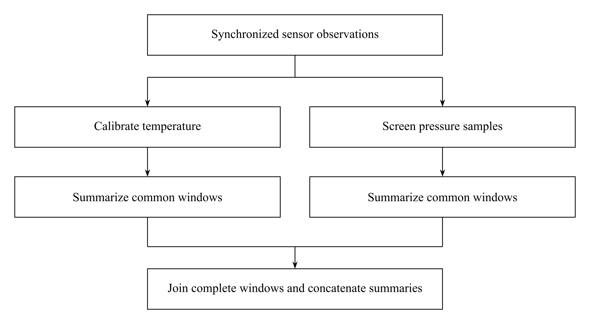
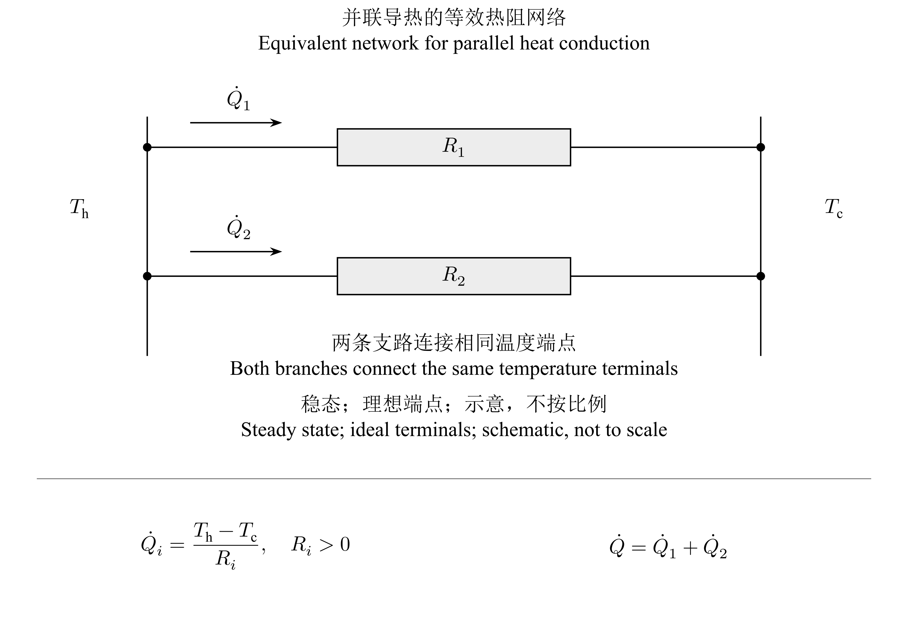
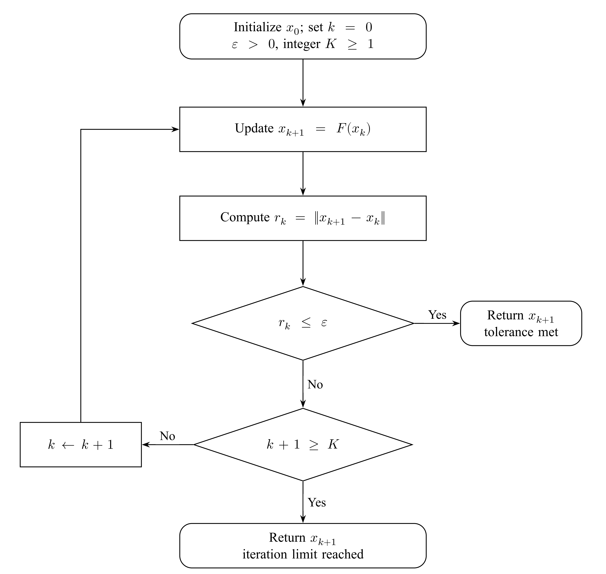
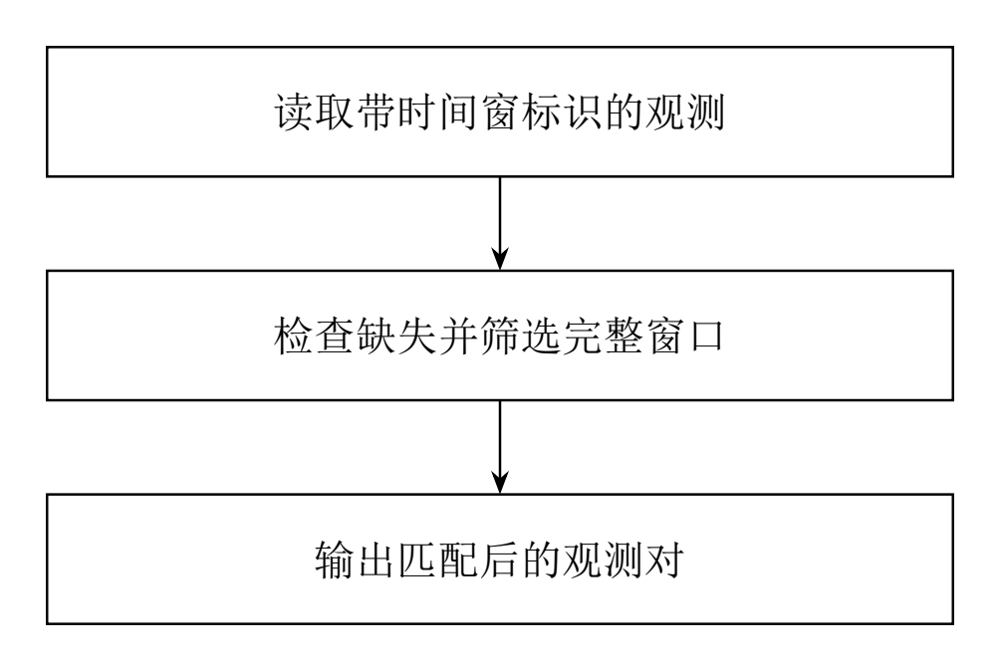

# Scientific TikZ Figures

**Editable research diagrams with Chinese, English and bilingual labels.**

[中文说明](README.zh-CN.md) · [Skill instructions](SKILL.md) · [Validation record](references/validation-record.md) · [Licence](LICENSE.txt)

Turn an author-defined scientific brief into TikZ workflows, algorithms, model architectures and physical-principle schematics. Keep equations editable and export PDF and PNG when the rendering tools are available.



## What you can make

| Figure | Editable source | PDF |
|---|---|---|
| English sensor architecture | [TEX](examples/example-en.tex) | [PDF](examples/example-en.pdf) |
| Bilingual physical principle | [TEX](examples/example-principle-bi.tex) | [PDF](examples/example-principle-bi.pdf) |
| English bounded algorithm | [TEX](examples/example-loop-en.tex) | [PDF](examples/example-loop-en.pdf) |
| Chinese workflow | [TEX](examples/example-workflow-zh.tex) | [PDF](examples/example-workflow-zh.pdf) |
| Academic-symbol proof sheet | [TEX](examples/symbol-coverage.tex) | [PDF](examples/symbol-coverage.pdf) |

All examples are original teaching material, not experimental results or reproduced paper figures.

## Quick start

### Use with an agent

Give a compatible agent access to [SKILL.md](SKILL.md) and the supporting resources, using the host's supported skill-loading method. For a local setup, the resources must be accessible to the agent. For marketplace delivery, follow the platform's temporary-script rules.

Try this brief:

> Create an English architecture diagram at most 160 mm wide. Split synchronized temperature and pressure observations into temperature calibration and pressure screening. Summarize identical windows, join complete window IDs and concatenate the summaries while retaining K and kPa as separate channels. Use Times New Roman, clear orthogonal arrows and black-and-white styling. Provide complete editable TikZ, a PDF, a 600 dpi PNG and a caption. This is a teaching example.

The agent designs and reviews the figure. The helper compiles and checks an existing source; it does not convert prose into diagrams on its own.

### Reproduce an example locally

Install Python 3.10+, XeLaTeX and the required TeX packages. Common packages are standalone, TikZ/PGF, fontspec, amsmath and unicode-math; Chinese/bilingual output also uses ctex. Use only fonts available under suitable terms in your environment.

Install the tested PDF/PNG dependencies, if needed:

```sh
python -m pip install -r requirements.txt
```

From the repository root, build and inspect the English example:

```sh
python scripts/figure_tool.py build assets/example-en.tex --out figure-build --language en --max-width-mm 160 --render --render-dpi 600
```

The helper prints a report path. Generated files and logs are in a new run directory under `figure-build`. Read the report and inspect the image before using it. Compile only trusted source; shell-escape disabling does not sandbox arbitrary TeX.

## Features

- Distinct design guidance for paper roadmaps, workflows, algorithms, model architectures and principle schematics.
- Chinese, English and bilingual labels; default SimSun and Times New Roman text with author overrides and disclosed fallbacks.
- Editable math and a [tested symbol sheet](references/academic-symbols.md): Greek, statistics, calculus, sets, vectors and matrices.
- Standalone helper for compilation, PDF dimensions, font embedding flags, text bounds, raster-object counts and basic language-character screening.
- Vector-first PDF and PNG export at 72–1200 dpi, with a 40-megapixel limit per page. The default PNG is a 150 dpi preview; choose final resolution explicitly.

## More examples

### Physical connectivity and equations



### Explicit decisions and termination



### Chinese typography



## Validation and limits

Version 1.0.0 passed **38 local tests** on Windows with Python 3.13.13, TeX Live 2026, pypdfium2 5.9.0 and Pillow 12.2.0. See the [detailed record](references/validation-record.md) and [machine-readable results](tests-public.json).

The five example PDFs were inspected with embedded fonts and no observed raster inclusions. Actual fonts included SimSun, Times New Roman and a disclosed Latin Modern Math fallback. Small mathematical scripts retain review flags. Missing glyphs and U+FFFD source corruption are rejected.

Mechanical checks do not certify scientific validity or collision-free layout. New figures require author review. Other operating systems and live marketplace loading remain unverified. This public v1.0.0 contains the marketplace profile, not the separate local development edition's project manager, automatic layout engine or private cases. No model weights, paper corpus, font files or dependency environments are bundled.

## Licence and contribution

**This is a public source repository under the existing proprietary [Marketplace Use Licence](LICENSE.txt), not an MIT-licensed open-source release.** Public visibility does not replace the licence. Authorised users may retain, edit, publish and commercially use generated figure outputs, subject to third-party rights. Redistribution or resale of the skill package itself is not granted. The creator may develop and publish the project; a future open-source licence decision must be explicit.

Bug reports and suggestions are welcome through [Issues](https://github.com/Mark22wen/scientific-tikz-figures/issues). Include the version, OS, dependency versions, a minimal non-confidential source and a redacted error excerpt. Do not include private manuscripts, credentials or full logs containing personal paths. Discuss substantial code contributions before sending them while the contribution licence remains unspecified.

If the project helps your research, a star makes it easier to find again and helps others discover it.
