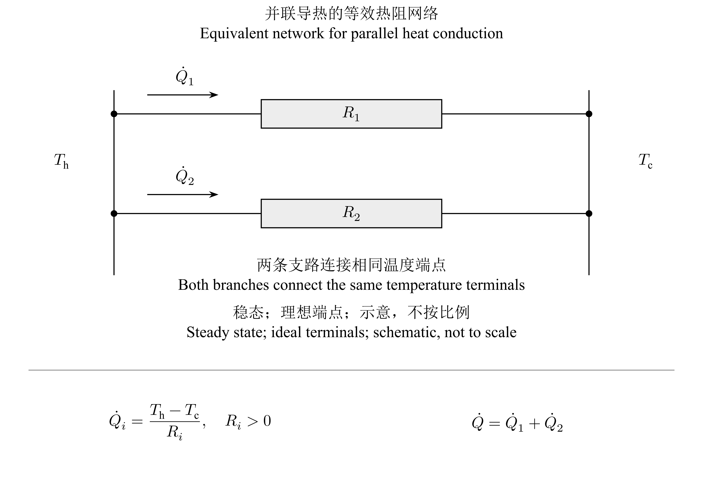

# Scientific TikZ Figures：科研论文示意图

[English](README.md) · [绘图规则](SKILL.md) · [实际测试记录](references/validation-record.md) · [使用许可](LICENSE.txt)

面向论文中的流程图、算法图、模型架构图和物理原理图。支持中文、英文、双语标签，保留可编辑公式，具备编译、PDF 检查和 PNG 导出功能。



## 快速试用

让支持技能加载的智能体读取本仓库的 `SKILL.md`，并能访问相关参考文件和模板。按智能体或平台实际支持的方法加载。然后提出具体绘图需求，例如：

> 绘制英文传感器处理架构图，宽度不超过 160 mm。同步温度和压力观测分别进入温度校准、压力筛查分支，再按同一时间窗汇总，只匹配完整时间窗并拼接两路特征。保留 K 与 kPa 的独立单位，使用 Times New Roman、黑白配色和清楚的直角箭头。交付可编辑 TEX、PDF、600 dpi PNG 与独立图注。这是教学示意，不含实验结果。

智能体根据需求编写并审查图；Python 辅助脚本负责对已有源文件编译与检查。

## 本地运行示例

需要 Python 3.10+、XeLaTeX、相应 TeX 宏包及可用字体。英文示例通常使用 standalone、TikZ/PGF、fontspec、amsmath、unicode-math；中文和双语另外使用 ctex。依赖和字体不随仓库提供。

```sh
python -m pip install -r requirements.txt
python scripts/figure_tool.py build assets/example-en.tex --out figure-build --language en --max-width-mm 160 --render --render-dpi 600
```

程序打印报告位置，成图和日志写入 `figure-build` 下独立运行目录。检查报告并查看实际图片后使用。只能编译可信源文件，关闭 shell escape 并不构成隔离运行环境。

## 示例下载

| 类型 | 可编辑源文件 | PDF |
|---|---|---|
| 英文架构 | [TEX](examples/example-en.tex) | [PDF](examples/example-en.pdf) |
| 双语原理 | [TEX](examples/example-principle-bi.tex) | [PDF](examples/example-principle-bi.pdf) |
| 循环算法 | [TEX](examples/example-loop-en.tex) | [PDF](examples/example-loop-en.pdf) |
| 中文流程 | [TEX](examples/example-workflow-zh.tex) | [PDF](examples/example-workflow-zh.pdf) |
| 学术符号测试页 | [TEX](examples/symbol-coverage.tex) | [PDF](examples/symbol-coverage.pdf) |

图均为原创教学示意，不代表实验结果。PDF 以矢量内容为主；如果使用位图素材，位图属性仍保留。PNG 可指定 72–1200 dpi，每页限 4000 万像素，默认 150 dpi 为预览。中文默认宋体，英文默认 Times New Roman，数学使用专门的数学字体；作者可覆盖，实际回退会披露。

## 已验证范围

v1.0.0 在 Windows 上通过 38 项本地测试，涉及正常构建、故障处理、语言、字体、缺字、画布限制和导出。五份示例 PDF 均检查到嵌入字体，未观察到嵌入位图。实际数学字体回退为 Latin Modern Math，数学下标的小字号提示保留。完整结果见 [验证记录](references/validation-record.md)。

新图仍需检查科学内容和最终布局。尚未验证其他系统或市场实时加载。本仓库是市场版，不包含本地开发版的多文件项目管理、自动布局引擎和私有用例库，也不包含论文语料、模型权重、字体或运行环境。

## 使用许可与反馈

当前公开源代码继续使用 [保留权利的市场使用许可](LICENSE.txt)，尚未改为 MIT 等开源许可。许可允许授权用户保留、修改、发表及商用生成的成图，不授予转售 skill 源包的权利。具体以许可正文及适用的第三方权利为准。

欢迎通过 [Issues](https://github.com/Mark22wen/scientific-tikz-figures/issues) 报告问题：提供版本、系统、依赖版本、最小示例和去除隐私的错误片段。请勿上传机密论文、密钥或包含个人路径的完整日志。代码贡献许可尚未明确，大改动请先讨论。

如果对你有帮助，欢迎点 Star 收藏，并反馈实际遇到的问题。
